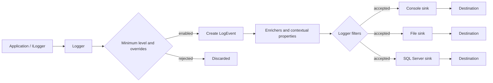

# Serilog and Logging in .NET: Technical Guide

**Audience:** .NET developers with basic C# knowledge  
**Scope:** Serilog concepts and a production-minded ASP.NET Core example. References were reviewed on 4 November 2026. Package versions change; pin compatible versions and consult package release notes before upgrades.

> **Project inspection:** The supplied workspace contains no `.sln`, `.csproj`, `Program.cs`, `appsettings*.json`, or package manifests. This guide therefore uses standard modern .NET examples rather than describing an existing application. No application code or configuration was changed.

## Contents

1. [Introduction](#1-introduction-to-logging)
2. [Architecture](#2-serilog-architecture)
3. [Configuration](#3-configuration-basics)
4. [Writing events](#4-writing-log-events)
5. [Structured data](#5-structured-logging-and-structured-data)
6. [Enrichers](#6-enrichers-and-context)
7. [Sinks](#7-sinks-and-logging-destinations)
8. [SQL Server sink](#8-sql-server-sink-deep-dive)
9. [End-to-end example](#9-end-to-end-aspnet-core-example)
10. [Team standard](#10-logging-best-practices-and-team-standard)
11. [Troubleshooting](#11-troubleshooting-and-common-mistakes)
12. [Quick reference](#12-quick-reference)
13. [Knowledge check](#13-knowledge-check)
14. [References and report](#14-official-references)

---

## 1. Introduction to logging

### What it is and why it matters

Logging records selected facts about a running program as timestamped events. A useful event says what happened, its severity, and includes properties that help an operator locate related work. In an order API, examples include `OrderId`, `TraceId`, outcome, and elapsed time.

Logs support production diagnosis, service health monitoring, capacity planning, and incident response. They become more useful when collected centrally so an operator can search across service instances. A log is not automatically an audit record: significant audit records need explicit integrity, access, retention, and completeness controls.

### Logging, debugging, and exception handling

| Practice | Purpose | Runtime use |
|---|---|---|
| Logging | Preserve selected operational facts for later search and aggregation | Available when configured; should be intentional |
| Debugging | Inspect execution interactively or with a debugger | Usually during development or targeted diagnosis |
| Exception handling | Decide how control flow responds to failure | Catch where code can recover, add context, translate, or clean up |

Logging does not handle an exception. Catching an exception does not automatically make it observable. At a boundary that owns the failure response, log the exception once with useful context. At lower layers, propagate unless there is a meaningful recovery action; repeated logging creates duplicates.

### Serilog and Microsoft.Extensions.Logging

Serilog is a .NET logging library built around structured log events. It provides a fluent configuration API, message templates with named properties, enrichment, filtering, and sinks. A sink adapts an event to a destination such as a console, file, database, or telemetry service. Sinks and enrichers are separate NuGet packages, often maintained by the community.

Microsoft.Extensions.Logging (MEL) is the logging abstraction used by ASP.NET Core and many libraries. `Serilog.Extensions.Logging` provides an MEL provider; `Serilog.AspNetCore` provides host integration and request logging. With host integration, application code can use `ILogger<T>` and framework logs can flow through Serilog, allowing structured sinks and enrichment without requiring every library to depend on Serilog.

Common enterprise uses include request completion and latency, business operation outcomes, dependency failures, background job lifecycle, external service calls, and startup/shutdown diagnostics. Avoid logging every method entry: high-volume noise costs storage and can bury useful events.

**References:** [Configuration Basics](https://github.com/serilog/serilog/wiki/Configuration-Basics), [Writing Log Events](https://github.com/serilog/serilog/wiki/Writing-Log-Events).

## 2. Serilog architecture

A logging call supplies a level, message template, values, and optionally an exception. If enabled, Serilog creates a `LogEvent` with timestamp, level, template, rendered message, exception, and properties. Enrichers add context; filters exclude events; sinks encode accepted events for destinations.



This is a conceptual view. Logger-level minimum checks can avoid creating disabled events. Per-sink minimum restrictions and filters determine which already-enabled events a sink writes. A global filter can reject an event for all sinks; sink-local filtering rejects it only for that destination. Multiple sinks can independently receive the same event.

| Component | Responsibility | Example |
|---|---|---|
| Logger | Accepts calls and applies configuration | `ILogger<OrderService>` |
| Log event | Structured record of one occurrence | Warning with `OrderId=42` |
| Message template | Stable event shape and property names | `Order {OrderId} accepted` |
| Properties | Typed values attached to event | `OrderId`, `TraceId` |
| Minimum level | Rejects events below a severity threshold | Global `Information` |
| Enricher | Adds properties | Machine name, request ID |
| Filter | Excludes matching events | Ignore health checks |
| Sink | Writes an event to destination | Console, MSSQL |
| Destructuring | Converts object to structured property data | `{@OrderSummary}` |

**References:** [Configuration Basics](https://github.com/serilog/serilog/wiki/Configuration-Basics), [Structured Data](https://github.com/serilog/serilog/wiki/Structured-Data).

## 3. Configuration basics

### 3.1 Creating a logger and its lifecycle

`LoggerConfiguration` is a builder. Add minimum levels, enrichers, filters, and sinks, then call `CreateLogger()`. `Log.Logger` is a convenient global logger. Prefer injected `ILogger<T>` within application code so components are testable and not tied to global state.

```csharp
using Serilog;

Log.Logger = new LoggerConfiguration()
    .MinimumLevel.Information()
    .WriteTo.Console()
    .CreateLogger();

try
{
    Log.Information("Application started");
    // Run application work.
}
finally
{
    Log.CloseAndFlush();
}
```

An unconfigured logger without a sink has nowhere to write. `CloseAndFlush()` closes the global logger and asks sinks that support flushing to drain buffers during orderly shutdown. With an ASP.NET Core host, `UseSerilog()` manages integration lifecycle; follow the host's async shutdown path and avoid competing global loggers.

### 3.2 Sinks

Sinks determine where log events are written. A service may send JSON to stdout for a container collector, rolling files for local diagnosis, and selected events to a central store. Multiple destinations serve different needs, but each adds I/O, cost, and failure modes. Configure each deliberately.

### 3.3 Logging levels

Serilog levels in ascending severity are `Verbose`, `Debug`, `Information`, `Warning`, `Error`, and `Fatal`.

| Level | Use | Example |
|---|---|---|
| Verbose | Very detailed, often high-volume detail | Per-item loop data during an investigation |
| Debug | Developer diagnostics | Cache decision or selected pricing rule |
| Information | Normal meaningful milestone | Order accepted; job completed |
| Warning | Unexpected/degraded condition without operation failure | Retry succeeded; ordinary invalid request |
| Error | An operation failed and needs attention | Order persistence failed |
| Fatal | Process/host cannot continue safely | Required startup dependency unavailable |

Choose severity based on operational impact. A validation failure from ordinary user input is not automatically an Error.

### 3.4 Namespace overrides

Overrides set thresholds by source category. Application code can remain at Information while noisy framework categories are restricted to Warning. More specific prefixes take precedence over broader ones.

```csharp
var logger = new LoggerConfiguration()
    .MinimumLevel.Information()
    .MinimumLevel.Override("Microsoft", Serilog.Events.LogEventLevel.Warning)
    .MinimumLevel.Override("Microsoft.AspNetCore", Serilog.Events.LogEventLevel.Warning)
    .MinimumLevel.Override("Microsoft.EntityFrameworkCore.Database.Command", Serilog.Events.LogEventLevel.Warning)
    .CreateLogger();
```

Tune EF Core categories to need: SQL command detail can help locally but may expose query values and create volume. Avoid sensitive parameter logging indiscriminately in production.

### 3.5 Logger minimum versus sink minimum

The global/category threshold decides whether a call becomes an event. A sink's `restrictedToMinimumLevel` decides whether that existing event is written by that sink. A sink cannot recover an event already rejected upstream.

| Setting | Applied to | Can recover globally rejected event? |
|---|---|---|
| `MinimumLevel.Information()` | Logger/event creation | No |
| `MinimumLevel.Override("X", Debug)` | Events from source X | No |
| `WriteTo.Console(restrictedToMinimumLevel: Debug)` | Console only | No |
| Sink filter | One sink branch | No |

With global Information and console restricted to Debug, a Debug call is still rejected globally. To capture Debug from one category, lower that category's logger override and let other sinks filter independently.

```csharp
var logger = new LoggerConfiguration()
    .MinimumLevel.Information()
    .MinimumLevel.Override("MyApp.Diagnostics", Serilog.Events.LogEventLevel.Debug)
    .WriteTo.Console(restrictedToMinimumLevel: Serilog.Events.LogEventLevel.Debug)
    .WriteTo.File("logs/app-.log", rollingInterval: RollingInterval.Day,
        restrictedToMinimumLevel: Serilog.Events.LogEventLevel.Information)
    .CreateLogger();
```

### 3.6 Code and appsettings configuration

Code configuration offers compile-time visibility. `Serilog.Settings.Configuration` maps `IConfiguration` to Serilog, useful for environment-specific thresholds. Install it, host integration, and each sink package separately.

```json
{
  "Serilog": {
    "Using": [ "Serilog.Sinks.Console", "Serilog.Sinks.File" ],
    "MinimumLevel": {
      "Default": "Information",
      "Override": { "Microsoft": "Warning", "Microsoft.AspNetCore": "Warning" }
    },
    "Enrich": [ "FromLogContext" ],
    "WriteTo": [
      { "Name": "Console" },
      { "Name": "File", "Args": {
        "path": "logs/app-.log", "rollingInterval": "Day", "retainedFileCountLimit": 14
      } }
    ],
    "Properties": { "Application": "Orders.Api" }
  }
}
```

Call `ReadFrom.Configuration(configuration)` after loading settings and ensure sink assemblies are present. `Using` helps discover configuration extensions. `appsettings.Development.json` may lower thresholds locally. Keep secrets out of checked-in JSON; load them from a secret provider. Names and options must match installed package versions.

**Reference:** [Configuration Basics](https://github.com/serilog/serilog/wiki/Configuration-Basics).

## 4. Writing log events

### Templates and named values

Serilog's `Log` methods and `ILogger` methods write events. In application services, use injected `ILogger<T>`; with Serilog host integration, events flow through Serilog. Named placeholders become properties.

```csharp
_logger.LogInformation("Order {OrderId} created for {UserId}", order.Id, userId);
```

The event retains the template and values independently of its rendered text, so a log store can query `OrderId` without parsing prose. Keep placeholder names stable and meaningful. Serilog message templates extend familiar .NET formatting; format specifiers affect rendering (`"Balance {Balance:C}"`) while retaining the captured value.

```csharp
// Structured: OrderId is a property.
logger.Information("Order {OrderId} created", orderId);

// One eagerly created string; no named OrderId property.
logger.Information($"Order {orderId} created");
```

The same principle applies to MEL. Prefer named properties to positional-only placeholders.

### Exceptions and avoiding duplicates

Pass an exception as the exception argument so the sink retains exception type, stack, and inner exception details:

```csharp
try
{
    await repository.SaveAsync(order, cancellationToken);
}
catch (SqlException ex)
{
    logger.LogError(ex, "Could not save order {OrderId}", order.Id);
    throw;
}
```

Log at the layer that owns the response or recovery. If this layer logs and rethrows and an API boundary logs again, the same failure appears twice. Lower layers should propagate unless adding distinct actionable context. Do not replace exception logging with only `{ExceptionMessage}`.

```csharp
// Good: stable template and queryable values.
logger.LogWarning("Payment retry {Attempt} failed for {OrderId}", attempt, orderId);

// Poor: embedded values cannot be reliably queried as named fields.
logger.LogWarning($"Payment retry {attempt} failed for {orderId}");
```

Log meaningful transitions and outcomes, not every method call. Include identifiers needed for diagnosis while excluding secrets and unnecessary personal information.

**Reference:** [Writing Log Events](https://github.com/serilog/serilog/wiki/Writing-Log-Events).

## 5. Structured logging and structured data

Traditional text logs render a sentence such as `Order 54 created in 120 ms`. Structured logging preserves a stable template plus typed properties. A platform can query `OrderId = 54`, aggregate duration, or group by operation without parsing the sentence.

Serilog represents values as scalars, sequences, structures, and dictionaries. Numbers, strings, booleans, dates, and selected reference types can be scalar. Collections become sequences; dictionaries retain key/value relationships; complex objects become structures when destructured. Sinks choose how to encode these sink-agnostic values, such as JSON or XML.

| Syntax | Meaning | Example |
|---|---|---|
| `{Property}` | Default capture behavior, often scalar/stringification | `"Customer {Customer}"` |
| `{@Property}` | Destructure object into structured members | `"Order {@OrderSummary}"` |
| `{$Property}` | Stringify via string representation | `"Response {$Response}"` |

```csharp
var summary = new { Id = order.Id, ItemCount = order.Items.Count };
logger.Information("Order {@OrderSummary} accepted", summary);
logger.Information("External response {$Response}", response);
```

Destructuring can expose large graphs, perform expensive property access, create high-volume events, or leak sensitive fields. Prefer small, safe DTOs. A custom `IDestructuringPolicy` can shape repeated type handling; keep the policy bounded and test against the installed Serilog version.

```csharp
logger.Information(
    "{OperationName} completed for order {OrderId} in {ExecutionDurationMs} ms",
    "CreateOrder", orderId, elapsed.TotalMilliseconds);
```

Add `UserId`, `RequestId`, or `TraceId` through scopes when policy permits. Each property can be queried independently. Use units in names (`ExecutionDurationMs`) and consistent casing. Avoid entire HTTP requests or arbitrary object graphs in every event.

**Reference:** [Structured Data](https://github.com/serilog/serilog/wiki/Structured-Data).

## 6. Enrichers and context

An enricher adds properties as events pass through a logger. Static values such as application name and environment belong in global enrichment. Request-specific values belong in a scope so unrelated concurrent work does not inherit them.

```csharp
var logger = new LoggerConfiguration()
    .Enrich.FromLogContext()
    .Enrich.WithProperty("Application", "Orders.Api")
    .CreateLogger();

using (Serilog.Context.LogContext.PushProperty("OrderId", orderId))
{
    logger.Information("Starting order workflow");
}
```

`Enrich.FromLogContext()` enables `LogContext.PushProperty()`. Dispose the returned scope with `using`. ASP.NET Core's `BeginScope()` properties can flow through the Serilog provider when configured; choose a consistent approach and verify properties arrive in sinks.

| Enricher | Package/API | Notes |
|---|---|---|
| Static property | Core `Enrich.WithProperty()` | No separate package |
| Log context | Core `Enrich.FromLogContext()` | Required for pushed context |
| Machine name | `Serilog.Enrichers.Environment`, `.WithMachineName()` | Host identity may be ephemeral |
| Environment name | `Serilog.Enrichers.Environment`, `.WithEnvironmentName()` | Verify package/target version |
| Thread ID | `Serilog.Enrichers.Thread`, `.WithThreadId()` | Managed thread ID at event time |

Install `Serilog.Enrichers.Thread` and configure `.Enrich.WithThreadId()` to add a property such as `ThreadId: 17` (actual value varies). Thread IDs help diagnose low-level scheduling but async continuations can resume on another thread, and threads are reused. They do not identify a logical request.

| Identifier | Meaning |
|---|---|
| Thread ID | Current managed execution thread; diagnostic hint |
| Request ID | One inbound HTTP request identifier; propagation is app-specific |
| Correlation ID | Business workflow identifier propagated across boundaries |
| Trace ID | Distributed trace identifier, typically with span IDs |

Prefer `Activity.Current?.TraceId` and ASP.NET Core tracing integration for cross-service traces. Custom enrichers implement `ILogEventEnricher`; keep them fast and avoid blocking I/O.

**References:** [Configuration Basics](https://github.com/serilog/serilog/wiki/Configuration-Basics), [Structured Data](https://github.com/serilog/serilog/wiki/Structured-Data).

## 7. Sinks and logging destinations

A sink receives accepted events and converts them to a destination-specific representation. Install its NuGet package, then configure `WriteTo` or configuration binding. The official catalog includes community packages; inclusion does not guarantee identical support or maintenance. Check each repository and NuGet compatibility.

| Sink | Typical package | Purpose and usage |
|---|---|---|
| Console | `Serilog.Sinks.Console` | Local development and container stdout collection |
| File | `Serilog.Sinks.File` | Rolling persistent diagnostic files |
| SQL Server | `Serilog.Sinks.MSSqlServer` | Relational storage and targeted reporting |
| Seq | `Serilog.Sinks.Seq` | Structured event search and monitoring |
| Elasticsearch | `Serilog.Sinks.Elasticsearch` | Search/analytics integration; verify current package status |

These are separate projects, not destinations guaranteed by Serilog core. Multiple sinks serve distinct needs; understand each sink's buffering and failure behavior. Container systems commonly collect stdout. File and database storage need explicit retention policies. Use per-sink restrictions where supported, remembering upstream filtering applies first.

**Reference:** [Provided Sinks](https://github.com/serilog/serilog/wiki/Provided-Sinks).

## 8. SQL Server sink deep dive

### Package, platforms, and options

The NuGet package is `Serilog.Sinks.MSSqlServer`; it writes to SQL Server and Azure SQL. The repository page reviewed lists minimum platforms including .NET Framework 4.6.2, .NET 8.0, and .NET Standard 2.0. Check the exact release's target frameworks and dependencies before adopting. It can write standard event fields, properties as XML `Properties` or JSON `LogEvent`, and selected properties as separate columns.

```powershell
dotnet add package Serilog.Sinks.MSSqlServer
```

For JSON configuration, add `Serilog.Settings.Configuration`. Pin compatible versions rather than using floating dependencies in production.

`MSSqlServerSinkOptions` configures table and batching. Common options include `TableName`, `SchemaName` (defaults to `dbo`), `AutoCreateSqlDatabase`, `AutoCreateSqlTable` (documented defaults are false), `BatchPostingLimit`, and `BatchPeriod`. If auto-creating a database, the documentation says table auto-creation should also be true. Production schema is often provisioned with reviewed migrations so types, permissions, and indexes are explicit.

`ColumnOptions.Store` lists standard columns present in the table. Typical standard fields include `Id`, `Message`, `MessageTemplate`, `Level`, `TimeStamp`, `Exception`, and `Properties`; the selected set and defaults depend on options/version. The table schema must agree with the configured columns.

### C# configuration and custom columns

```csharp
using System.Collections.ObjectModel;
using System.Data;
using Serilog;
using Serilog.Sinks.MSSqlServer;

var columnOptions = new ColumnOptions();
columnOptions.Store.Remove(StandardColumn.Properties);
columnOptions.Store.Add(StandardColumn.LogEvent);
columnOptions.Store.Add(StandardColumn.TraceId);
columnOptions.Store.Add(StandardColumn.SpanId);
columnOptions.AdditionalColumns = new Collection<SqlColumn>
{
    new() { ColumnName = "OrderId", PropertyName = "OrderId", DataType = SqlDbType.BigInt,
        AllowNull = true, NonClusteredIndex = true },
    new() { ColumnName = "OperationName", DataType = SqlDbType.NVarChar,
        DataLength = 64, AllowNull = true }
};

var sinkOptions = new MSSqlServerSinkOptions
{
    TableName = "Logs", SchemaName = "dbo", AutoCreateSqlTable = false,
    BatchPostingLimit = 100, BatchPeriod = TimeSpan.FromSeconds(5)
};

var logger = new LoggerConfiguration()
    .MinimumLevel.Information()
    .WriteTo.MSSqlServer(
        connectionString: connectionString,
        sinkOptions: sinkOptions,
        columnOptions: columnOptions,
        restrictedToMinimumLevel: Serilog.Events.LogEventLevel.Warning)
    .CreateLogger();
```

`OrderId` maps the structured property named `OrderId`; `OperationName` also maps by matching its column name. Choose SQL types, nullability, lengths, and indexes for actual event shapes and queries. Fixed character lengths can truncate values. Hierarchical property mapping is supported, but collection indexing is not supported by documented property-name resolution.

### JSON/XML properties versus dedicated columns

`Properties` stores structured properties as XML; `LogEvent` stores a JSON event representation. The sink documentation recommends typically choosing one catch-all representation rather than both. JSON querying with `JSON_VALUE` requires SQL Server 2016 or newer per its documentation. Dedicated columns provide direct typed predicates and indexing for frequently queried properties but require schema maintenance. Redundant data can be excluded with `Properties.ExcludeAdditionalProperties` or `LogEvent.ExcludeAdditionalProperties`; JSON can also exclude standard columns.

### Illustrative SQL schema and query

Provision a schema that exactly matches `ColumnOptions`. A simplified example for the settings above is:

```sql
CREATE TABLE dbo.Logs
(
    Id bigint IDENTITY(1,1) NOT NULL CONSTRAINT PK_Logs PRIMARY KEY NONCLUSTERED,
    Message nvarchar(max) NULL,
    MessageTemplate nvarchar(max) NULL,
    Level nvarchar(128) NULL,
    TimeStamp datetimeoffset NULL,
    Exception nvarchar(max) NULL,
    LogEvent nvarchar(max) NULL,
    TraceId varchar(32) NULL,
    SpanId varchar(16) NULL,
    OrderId bigint NULL,
    OperationName nvarchar(64) NULL
);
CREATE INDEX IX_Logs_OrderId_TimeStamp ON dbo.Logs(OrderId, TimeStamp);
```

This is illustrative. Match actual names, types, nullability, identity/index choices, serialized type, and package version. Test a migration against SQL Server before deployment.

```csharp
logger.Information("{OperationName} accepted order {OrderId}", "CreateOrder", orderId);
```

```sql
SELECT TOP (100) TimeStamp, Level, Message, OrderId, TraceId
FROM dbo.Logs
WHERE OrderId = @OrderId
ORDER BY TimeStamp DESC;
```

To query a property stored in JSON instead of a dedicated column, the sink docs show this pattern:

```sql
SELECT TimeStamp, Message,
       JSON_VALUE(LogEvent, '$.Properties.OrderId') AS OrderId
FROM dbo.Logs
WHERE JSON_VALUE(LogEvent, '$.Properties.OrderId') = '42';
```

### Batching, failures, and operations

Batching groups writes to improve throughput. `BatchPostingLimit` bounds rows and `BatchPeriod` controls the interval. This adds write latency and means recent events may remain buffered. Flush on orderly shutdown; do not assume buffering guarantees delivery during forced termination or database outages. Validate exact failure behavior for the deployed package version.

Index according to real queries, often timestamp, level, trace/order identifiers; indexes increase write cost. Define retention through scheduled deletion, archive, or partitioning. Bound payload sizes and event volume. Use a dedicated least-privilege database principal and provision the table separately in secured production deployments; the sink docs note that table-specific grants require a pre-existing table. Protect connection strings as secrets, encrypt connections as policy requires, and never log credentials.

Sink-internal diagnostics can be directed through Serilog `SelfLog` during investigation. Send it to a separate stream rather than the malfunctioning destination. Monitor database availability, write failures, and storage growth. Ensure a slow or unavailable log store cannot unexpectedly block business operations.

### Configuration-driven setup

The sink repository documents `Serilog.Settings.Configuration` support. A representative section shape is:

```json
{
  "Serilog": {
    "Using": [ "Serilog.Sinks.MSSqlServer" ],
    "WriteTo": [{
      "Name": "MSSqlServer",
      "Args": {
        "connectionString": "provided-by-secret-configuration",
        "sinkOptionsSection": {
          "tableName": "Logs", "schemaName": "dbo",
          "autoCreateSqlTable": false,
          "batchPostingLimit": 100, "batchPeriod": "00:00:05"
        },
        "restrictedToMinimumLevel": "Warning",
        "columnOptionsSection": {
          "addStandardColumns": [ "LogEvent", "TraceId", "SpanId" ],
          "removeStandardColumns": [ "Properties" ],
          "additionalColumns": [
            { "ColumnName": "OrderId", "DataType": "bigint", "AllowNull": true,
              "NonClusteredIndex": true }
          ]
        }
      }
    }]
  }
}
```

Names and enum/type binding are version-sensitive. Environment variable expansion is configuration-provider dependent; do not assume `${...}` is automatically expanded. Validate this shape against the installed package README. Some `ColumnOptions` predicates cannot be expressed in configuration.

**Primary reference:** [Serilog.Sinks.MSSqlServer repository](https://github.com/serilog-mssql/serilog-sinks-mssqlserver).

## 9. End-to-end ASP.NET Core example

This example uses standard hosting integration. Install compatible versions of `Serilog.AspNetCore`, `Serilog.Settings.Configuration`, `Serilog.Sinks.Console`, `Serilog.Sinks.File`, `Serilog.Sinks.MSSqlServer`, `Serilog.Enrichers.Environment`, and optionally `Serilog.Enrichers.Thread`. Match `Serilog.AspNetCore` to the ASP.NET Core major version. SQL configuration is in code to make SQL options visible.

```csharp
using System.Collections.ObjectModel;
using System.Data;
using System.Diagnostics;
using Serilog;
using Serilog.Context;
using Serilog.Events;
using Serilog.Sinks.MSSqlServer;

var builder = WebApplication.CreateBuilder(args);
var sqlConnection = builder.Configuration.GetConnectionString("LogDatabase");

var columns = new ColumnOptions();
columns.Store.Remove(StandardColumn.Properties);
columns.Store.Add(StandardColumn.LogEvent);
columns.Store.Add(StandardColumn.TraceId);
columns.Store.Add(StandardColumn.SpanId);
columns.AdditionalColumns = new Collection<SqlColumn>
{
    new() { ColumnName = "OrderId", DataType = SqlDbType.BigInt, AllowNull = true,
        NonClusteredIndex = true },
    new() { ColumnName = "OperationName", DataType = SqlDbType.NVarChar,
        DataLength = 64, AllowNull = true }
};
var sqlOptions = new MSSqlServerSinkOptions
{
    TableName = "Logs", SchemaName = "dbo", AutoCreateSqlTable = false,
    BatchPostingLimit = 100, BatchPeriod = TimeSpan.FromSeconds(5)
};

builder.Host.UseSerilog((context, services, config) => config
    .ReadFrom.Configuration(context.Configuration)
    .ReadFrom.Services(services)
    .Enrich.FromLogContext()
    .Enrich.WithProperty("Application", "Orders.Api")
    .Enrich.WithEnvironmentName()
    .Enrich.WithMachineName()
    .MinimumLevel.Override("Microsoft", LogEventLevel.Warning)
    .MinimumLevel.Override("Microsoft.AspNetCore", LogEventLevel.Warning)
    .MinimumLevel.Override("Microsoft.EntityFrameworkCore.Database.Command", LogEventLevel.Warning)
    .WriteTo.Console(restrictedToMinimumLevel: LogEventLevel.Debug)
    .WriteTo.File("logs/orders-.log", rollingInterval: RollingInterval.Day,
        retainedFileCountLimit: 14,
        restrictedToMinimumLevel: LogEventLevel.Information)
    .WriteTo.MSSqlServer(
        connectionString: sqlConnection!, sinkOptions: sqlOptions,
        columnOptions: columns,
        restrictedToMinimumLevel: LogEventLevel.Warning));

builder.Services.AddControllers();
builder.Services.AddScoped<IOrderService, OrderService>();
var app = builder.Build();

app.Use(async (context, next) =>
{
    using (LogContext.PushProperty("RequestId", context.TraceIdentifier))
    using (LogContext.PushProperty("TraceId", Activity.Current?.TraceId.ToString()))
        await next();
});

app.UseSerilogRequestLogging(options =>
{
    options.MessageTemplate = "HTTP {RequestMethod} {RequestPath} responded {StatusCode} in {Elapsed:0.0000} ms";
    options.GetLevel = (http, elapsed, exception) => exception is not null || http.Response.StatusCode >= 500
        ? LogEventLevel.Error
        : http.Response.StatusCode >= 400 ? LogEventLevel.Warning : LogEventLevel.Information;
});

app.MapControllers();
try
{
    Log.Information("Starting Orders API");
    await app.RunAsync();
}
catch (Exception ex)
{
    Log.Fatal(ex, "Orders API terminated unexpectedly");
    throw;
}
finally
{
    await Log.CloseAndFlushAsync();
}

public sealed class OrderService : IOrderService
{
    private readonly ILogger<OrderService> _logger;
    private readonly IOrderRepository _repository;
    public OrderService(ILogger<OrderService> logger, IOrderRepository repository)
        => (_logger, _repository) = (logger, repository);

    public async Task<Order> CreateAsync(CreateOrder request, string userId, CancellationToken ct)
    {
        if (request.Items.Count == 0)
        {
            _logger.LogWarning("Order validation failed: no items for user {UserId}", userId);
            throw new OrderValidationException("At least one item is required.");
        }
        var order = Order.From(request, userId);
        _logger.LogInformation("Creating order {OrderId} for user {UserId}", order.Id, userId);
        try
        {
            await _repository.InsertAsync(order, ct);
        }
        catch (Exception ex)
        {
            _logger.LogError(ex, "Database operation failed for order {OrderId}", order.Id);
            throw;
        }
        _logger.LogInformation("Order {OrderId} created successfully", order.Id);
        return order;
    }
}
```

`IOrderService`, `IOrderRepository`, `Order`, `CreateOrder`, and `OrderValidationException` are application contracts omitted for brevity, so this is a focused integration sample rather than a standalone compiling project. Avoid logging the same failure both in the service and exception boundary; choose one owner or ensure lower-level context is distinct. Apply the data classification policy to `UserId`. Authentication events must not include credentials or tokens. The SQL connection should come from a secret provider.

`ReadFrom.Configuration()` can load common levels and sink settings from appsettings; the code configures SQL and enrichers. `CloseAndFlushAsync()` exists in modern Serilog versions; use the shutdown API provided by the chosen version. Validate host lifecycle for the installed `Serilog.AspNetCore` and sink versions.

| Scenario | Useful event data | Likely destinations |
|---|---|---|
| Incoming HTTP request | Method, path, status, elapsed, TraceId | Console/file; SQL per volume and policy |
| Authentication | Outcome, safe subject ID, reason category | Security event store; no token/password |
| Create order | OrderId, operation, outcome | Sinks above their thresholds |
| Database operation | Exception and order/dependency context | Warning/Error destinations |
| Validation failure | Stable reason and request context | Console/file; level reflects business meaning |
| Unhandled exception | Exception at owning boundary | Error and higher destinations |
| Successful request | Completion status and latency | Request sink; consider health-check noise |

In this configuration console can accept Debug only when upstream thresholds allow it; file accepts Information and above; SQL accepts Warning and above. Sink minima never bypass the logger minimum.

## 10. Logging best practices and team standard

Every important event should use a stable message template and include the operation, outcome, and safe identifiers needed for diagnosis. Use consistent names and units. Attach trace/request context once through middleware or scopes. Log exception objects at the layer that owns failure handling.

| Recommended | Discouraged |
|---|---|
| `logger.LogInformation("Order {OrderId} accepted", id)` | Interpolated or concatenated log text |
| Warning for recoverable degradation; Error for failed operation | Treat every client validation error as Error |
| Log an exception once at an actionable boundary | Catch, log, and rethrow at every layer |
| Add TraceId/RequestId through request context | Use ThreadId to trace an async request |
| Log allowlisted identifiers and outcomes | Passwords, tokens, cookies, secrets, full connection strings |
| Use small DTOs for destructuring | Destructure entities or request bodies by default |
| Tune framework overrides and production levels | Leave verbose EF/HTTP diagnostics on without controls |
| Understand buffering and delivery limits | Assume sink outage cannot cause delay or event loss |
| Apply retention, access, and size limits | Retain unbounded files/tables |
| Sample or filter repetitive health-check success events | Emit high-volume success events without a use case |

### Layer and environment guidance

- **Middleware/controllers:** record request outcome once and translate exceptions to responses. Avoid duplicating service logs.
- **Services:** log business milestones and decisions with domain identifiers, not every method call.
- **Repositories:** add useful dependency context when needed; propagate failures. Avoid duplicating SQL text or parameter values.
- **Background workers:** include job name, run ID, attempt, and outcome; make terminal failure clear.
- **Production:** Information is a common baseline. Tune by cost, sensitivity, and operational need. Keep Debug/Verbose off unless enabled through controlled diagnostics.

Protect logs as sensitive operational data. Minimize personal data, omit secrets, restrict access, encrypt where policy requires, and define retention/deletion. Logging consumes CPU, allocations, I/O, and ingestion capacity. Avoid expensive object construction for disabled levels; keep events bounded. Logs should not be the only source of business truth.

## 11. Troubleshooting and common mistakes

| Symptom | Cause | Diagnose | Fix |
|---|---|---|---|
| No logs appear | No sink, host not wired, wrong config section | Emit startup event; inspect provider and configuration | Add sink and call `UseSerilog()` or register provider |
| Debug missing | Global/category threshold rejects it | Inspect effective minimum and namespace | Lower logger threshold; sink minimum alone cannot help |
| Sink level seems ignored | Upstream logger discarded event | Compare global and sink thresholds | Allow event upstream, then restrict per sink |
| SQL connection failure | Secret, network/TLS, permissions, or server issue | Enable SelfLog; test connectivity and identity | Fix secret/network/grant; avoid broad permissions |
| Table schema mismatch | Options differ from actual table | Compare `ColumnOptions` and schema | Align migration and options; test exact package |
| Custom column is null | Property name or type mismatch | Inspect event properties and mapping | Match `PropertyName`, SQL type, and nullability |
| Custom fields missing | Interpolation or context enricher absent | Inspect template/properties and column set | Use named templates; enable `FromLogContext`; select XML/JSON property storage |
| Object appears as type string | Default capture did not destructure | Inspect template operator | Use `{@Object}` for safe DTO or custom policy |
| Thread ID absent | Package/configuration missing | Check package and enricher setup | Add compatible package; use TraceId for async flow |
| Duplicate exception events | Multiple layers log and rethrow | Search same trace/exception | Choose one owning boundary |
| Slow app or storage growth | Excess volume, large objects, slow destination | Measure rate, payload, sink errors | Reduce volume, bound fields, tune capacity/batching |
| Tail events lost | Termination before buffered flush | Review shutdown and process termination | Allow graceful shutdown; forced kills can still lose buffered events |

`Serilog.Debugging.SelfLog.Enable(TextWriter)` can expose internal sink/configuration failures. Send it to a separate stream; feeding it into the same malfunctioning destination can conceal the issue.

## 12. Quick reference

### Levels and calls

```csharp
logger.LogTrace("Detailed trace {ItemId}", itemId);          // MEL Trace / Serilog Verbose
logger.LogDebug("Cache miss for {Key}", key);
logger.LogInformation("Order {OrderId} accepted", id);
logger.LogWarning("Retry {Attempt} for {OrderId}", attempt, id);
logger.LogError(exception, "Order {OrderId} failed", id);
logger.LogCritical(exception, "Host cannot continue");       // Serilog Fatal
```

MEL uses Trace, Debug, Information, Warning, Error, Critical; Serilog uses Verbose, Debug, Information, Warning, Error, Fatal.

### Templates, objects, context, and SQL

```csharp
logger.LogInformation("Order {OrderId} total {Total:C}", orderId, total);
logger.LogInformation("Summary {@Summary}", safeSummary);
logger.LogInformation("Payload {$Payload}", payload);

new LoggerConfiguration()
    .MinimumLevel.Information()
    .MinimumLevel.Override("Microsoft", LogEventLevel.Warning)
    .Enrich.FromLogContext()
    .Enrich.WithProperty("Application", "Orders.Api");

.WriteTo.MSSqlServer(
    connectionString: connectionString,
    sinkOptions: new MSSqlServerSinkOptions
        { TableName = "Logs", AutoCreateSqlTable = false },
    columnOptions: columnOptions,
    restrictedToMinimumLevel: LogEventLevel.Warning)
```

Use package `Serilog.Sinks.MSSqlServer`; select intended standard columns in `ColumnOptions.Store` and define typed fields in `AdditionalColumns`. Database schema and options must agree.

## 13. Knowledge check

1. **What does a sink do?** Writes an accepted event to a destination in that destination's format.
2. **What does the global minimum do?** Decides whether a call becomes a log event.
3. **Can a Debug-only sink receive Debug when global minimum is Information?** No; the logger rejects the call before routing.
4. **Why use `{OrderId}` instead of interpolation?** It captures a named structured property separate from rendered text.
5. **What does `{@Order}` request?** Destructuring into structured members, subject to policies/limits.
6. **What does `{$Response}` request?** Stringification through the object's string representation.
7. **What does `Enrich.FromLogContext()` enable?** Properties pushed into Serilog's ambient scoped context.
8. **Why is Thread ID insufficient for request tracing?** Async work can switch threads and threads are reused; use trace/request context.
9. **What is a Trace ID for?** Connecting spans/events across a distributed operation.
10. **Should every layer log and rethrow the same exception?** No; choose one actionable owner.
11. **What does MSSQL `Properties` store?** Structured properties serialized as XML when enabled.
12. **What is MSSQL `LogEvent`?** JSON event representation when selected.
13. **Why map a property to a SQL column?** Typed querying and indexing, in exchange for schema management.
14. **What must match for custom-column mapping?** Event property name/value type and configured SQL column definition.
15. **What does `AutoCreateSqlTable` do?** Creates a missing table when enabled; documented default is false.
16. **Why batch database writes?** Better throughput, with added latency and buffered shutdown behavior.
17. **Should an Error event include a password?** No; severity does not make sensitive data safe.
18. **What does `Log.CloseAndFlush()` do?** Closes the global logger and flushes sinks that support orderly flush.
19. **Why override Microsoft namespaces?** Framework diagnostics can be noisy; retain useful warnings/errors with less volume.
20. **Are all listed sinks maintained by Serilog core?** No; the catalog includes community packages with separate support status.

## 14. Official references

All required sources were opened and reviewed on 4 November 2026:

1. [Serilog Configuration Basics](https://github.com/serilog/serilog/wiki/Configuration-Basics)
2. [Writing Log Events](https://github.com/serilog/serilog/wiki/Writing-Log-Events)
3. [Structured Data](https://github.com/serilog/serilog/wiki/Structured-Data)
4. [Provided Sinks](https://github.com/serilog/serilog/wiki/Provided-Sinks)
5. [Serilog.Sinks.MSSqlServer documentation](https://github.com/serilog-mssql/serilog-sinks-mssqlserver)

### Completion report

- **File created:** `docs/Serilog-Logging-Technical-Guide.md` in the task outputs folder.
- **References reviewed:** All five required sources listed above.
- **Topics documented:** Logging fundamentals, event pipeline, levels and filtering, templates, structured values, enrichment and correlation IDs, destination choice, SQL Server storage/operations, ASP.NET Core example, team standards, troubleshooting, quick reference, and 20 questions with answers.
- **Project findings:** No solution, project, or logging configuration was present in the supplied workspace. Examples use standard modern ASP.NET Core patterns.
- **Assumptions/verification limits:** Package and host APIs are version-sensitive. SQL sink options and configuration shapes were checked against its repository documentation, but the illustrative SQL schema and complete host sample were not compiled against an existing project. Validate package compatibility and schema with the team's target framework before adoption.
