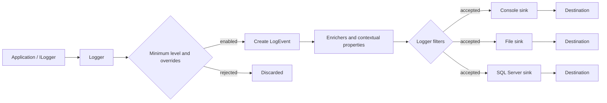
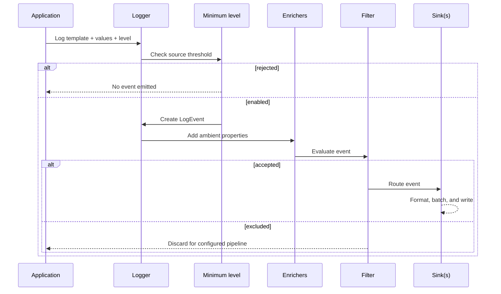

# Serilog architecture

A logging call supplies a level, message template, values, and optionally an exception. If enabled, Serilog creates a `LogEvent` with timestamp, level, template, rendered message, exception, and properties. Enrichers add context; filters exclude events; sinks encode accepted events for destinations.

This is a conceptual view. Logger-level minimum checks can avoid creating disabled events. Per-sink minimum restrictions and filters determine which already-enabled events a sink writes. A global filter can reject an event for all sinks; sink-local filtering rejects it only for that destination. Multiple sinks can independently receive the same event.

| Component | Responsibility | Example |
|---|---|---|
| Logger | Accepts calls and applies configuration | `ILogger<OrderService>` |
| Log event | Structured record of one occurrence | Warning with `OrderId=42` |
| Message template | Stable event shape and property names | `Order {OrderId} accepted` |
| Properties | Typed values attached to event | `OrderId`, `TraceId` |
| Minimum level | Rejects events below a severity threshold | Global `Information` |
| Enricher | Adds properties | Machine name, request ID |
| Filter | Excludes matching events | Ignore health checks |
| Sink | Writes an event to destination | Console, MSSQL |
| Destructuring | Converts object to structured property data | `{@OrderSummary}` |

**References:** [Configuration Basics](https://github.com/serilog/serilog/wiki/Configuration-Basics), [Structured Data](https://github.com/serilog/serilog/wiki/Structured-Data).

## Log event lifecycle

The following sequence shows the stages an enabled call passes through. Exact internal evaluation order can vary with pipeline construction and sink wrappers; the key operational point is that an event rejected by the logger is unavailable to downstream sinks.

