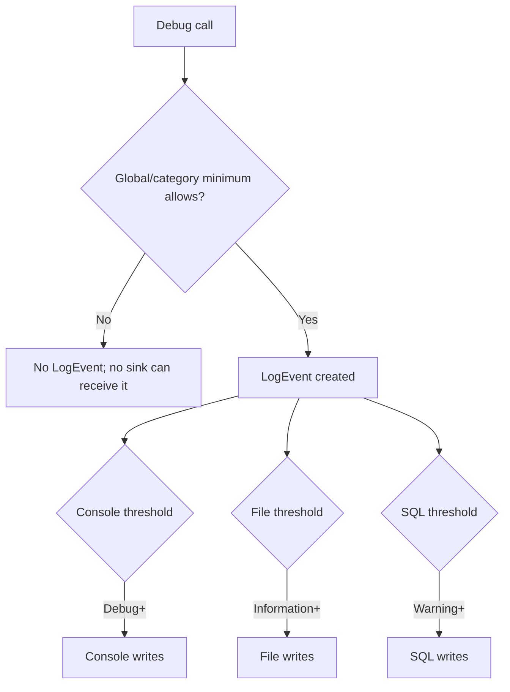

# Configuration basics

## Creating a logger and its lifecycle {#logger-lifecycle}

`LoggerConfiguration` is a builder. Add minimum levels, enrichers, filters, and sinks, then call `CreateLogger()`. `Log.Logger` is a convenient global logger. Prefer injected `ILogger<T>` within application code so components are testable and not tied to global state.

```csharp
using Serilog;

Log.Logger = new LoggerConfiguration()
    .MinimumLevel.Information()
    .WriteTo.Console()
    .CreateLogger();

try
{
    Log.Information("Application started");
    // Run application work.
}
finally
{
    Log.CloseAndFlush();
}
```

An unconfigured logger without a sink has nowhere to write. `CloseAndFlush()` closes the global logger and asks sinks that support flushing to drain buffers during orderly shutdown. With an ASP.NET Core host, `UseSerilog()` manages integration lifecycle; follow the host's async shutdown path and avoid competing global loggers.

## 3.2 Sinks

Sinks determine where log events are written. A service may send JSON to stdout for a container collector, rolling files for local diagnosis, and selected events to a central store. Multiple destinations serve different needs, but each adds I/O, cost, and failure modes. Configure each deliberately.

## Logging levels {#logging-levels}

Serilog levels in ascending severity are `Verbose`, `Debug`, `Information`, `Warning`, `Error`, and `Fatal`.

| Level | Use | Example |
|---|---|---|
| Verbose | Very detailed, often high-volume detail | Per-item loop data during an investigation |
| Debug | Developer diagnostics | Cache decision or selected pricing rule |
| Information | Normal meaningful milestone | Order accepted; job completed |
| Warning | Unexpected/degraded condition without operation failure | Retry succeeded; ordinary invalid request |
| Error | An operation failed and needs attention | Order persistence failed |
| Fatal | Process/host cannot continue safely | Required startup dependency unavailable |

Choose severity based on operational impact. A validation failure from ordinary user input is not automatically an Error.

## Namespace overrides {#namespace-overrides}

Overrides set thresholds by source category. Application code can remain at Information while noisy framework categories are restricted to Warning. More specific prefixes take precedence over broader ones.

```csharp
var logger = new LoggerConfiguration()
    .MinimumLevel.Information()
    .MinimumLevel.Override("Microsoft", Serilog.Events.LogEventLevel.Warning)
    .MinimumLevel.Override("Microsoft.AspNetCore", Serilog.Events.LogEventLevel.Warning)
    .MinimumLevel.Override("Microsoft.EntityFrameworkCore.Database.Command", Serilog.Events.LogEventLevel.Warning)
    .CreateLogger();
```

Tune EF Core categories to need: SQL command detail can help locally but may expose query values and create volume. Avoid sensitive parameter logging indiscriminately in production.

## Logger minimum versus sink minimum {#logger-minimum-versus-sink-minimum}

The global/category threshold decides whether a call becomes an event. A sink's `restrictedToMinimumLevel` decides whether that existing event is written by that sink. A sink cannot recover an event already rejected upstream.

| Setting | Applied to | Can recover globally rejected event? |
|---|---|---|
| `MinimumLevel.Information()` | Logger/event creation | No |
| `MinimumLevel.Override("X", Debug)` | Events from source X | No |
| `WriteTo.Console(restrictedToMinimumLevel: Debug)` | Console only | No |
| Sink filter | One sink branch | No |

With global Information and console restricted to Debug, a Debug call is still rejected globally. To capture Debug from one category, lower that category's logger override and let other sinks filter independently.

```csharp
var logger = new LoggerConfiguration()
    .MinimumLevel.Information()
    .MinimumLevel.Override("MyApp.Diagnostics", Serilog.Events.LogEventLevel.Debug)
    .WriteTo.Console(restrictedToMinimumLevel: Serilog.Events.LogEventLevel.Debug)
    .WriteTo.File("logs/app-.log", rollingInterval: RollingInterval.Day,
        restrictedToMinimumLevel: Serilog.Events.LogEventLevel.Information)
    .CreateLogger();
```

## Code and appsettings configuration {#code-and-appsettings-configuration}

Code configuration offers compile-time visibility. `Serilog.Settings.Configuration` maps `IConfiguration` to Serilog, useful for environment-specific thresholds. Install it, host integration, and each sink package separately.

```json
{
  "Serilog": {
    "Using": [ "Serilog.Sinks.Console", "Serilog.Sinks.File" ],
    "MinimumLevel": {
      "Default": "Information",
      "Override": { "Microsoft": "Warning", "Microsoft.AspNetCore": "Warning" }
    },
    "Enrich": [ "FromLogContext" ],
    "WriteTo": [
      { "Name": "Console" },
      { "Name": "File", "Args": {
        "path": "logs/app-.log", "rollingInterval": "Day", "retainedFileCountLimit": 14
      } }
    ],
    "Properties": { "Application": "Orders.Api" }
  }
}
```

Call `ReadFrom.Configuration(configuration)` after loading settings and ensure sink assemblies are present. `Using` helps discover configuration extensions. `appsettings.Development.json` may lower thresholds locally. Keep secrets out of checked-in JSON; load them from a secret provider. Names and options must match installed package versions.

**Reference:** [Configuration Basics](https://github.com/serilog/serilog/wiki/Configuration-Basics).


## Logger and sink filtering flow



For example, an Information global minimum prevents a Debug event from reaching even a sink configured for Debug. Lower a category override to Debug when that category needs diagnostic events, then use each sink threshold to control its own volume.


