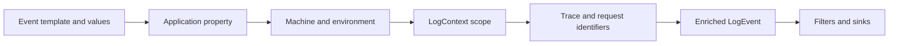

# Enrichers and context

An enricher adds properties as events pass through a logger. Static values such as application name and environment belong in global enrichment. Request-specific values belong in a scope so unrelated concurrent work does not inherit them.

```csharp
var logger = new LoggerConfiguration()
    .Enrich.FromLogContext()
    .Enrich.WithProperty("Application", "Orders.Api")
    .CreateLogger();

using (Serilog.Context.LogContext.PushProperty("OrderId", orderId))
{
    logger.Information("Starting order workflow");
}
```

`Enrich.FromLogContext()` enables `LogContext.PushProperty()`. Dispose the returned scope with `using`. ASP.NET Core's `BeginScope()` properties can flow through the Serilog provider when configured; choose a consistent approach and verify properties arrive in sinks.

| Enricher | Package/API | Notes |
|---|---|---|
| Static property | Core `Enrich.WithProperty()` | No separate package |
| Log context | Core `Enrich.FromLogContext()` | Required for pushed context |
| Machine name | `Serilog.Enrichers.Environment`, `.WithMachineName()` | Host identity may be ephemeral |
| Environment name | `Serilog.Enrichers.Environment`, `.WithEnvironmentName()` | Verify package/target version |
| Thread ID | `Serilog.Enrichers.Thread`, `.WithThreadId()` | Managed thread ID at event time |

Install `Serilog.Enrichers.Thread` and configure `.Enrich.WithThreadId()` to add a property such as `ThreadId: 17` (actual value varies). Thread IDs help diagnose low-level scheduling but async continuations can resume on another thread, and threads are reused. They do not identify a logical request.

| Identifier | Meaning |
|---|---|
| Thread ID | Current managed execution thread; diagnostic hint |
| Request ID | One inbound HTTP request identifier; propagation is app-specific |
| Correlation ID | Business workflow identifier propagated across boundaries |
| Trace ID | Distributed trace identifier, typically with span IDs |

Prefer `Activity.Current?.TraceId` and ASP.NET Core tracing integration for cross-service traces. Custom enrichers implement `ILogEventEnricher`; keep them fast and avoid blocking I/O.

**References:** [Configuration Basics](https://github.com/serilog/serilog/wiki/Configuration-Basics), [Structured Data](https://github.com/serilog/serilog/wiki/Structured-Data).


## Enrichment pipeline



Static enrichers provide service identity. Scoped context contributes request-specific properties while the scope is active. Use a distributed Trace ID across service calls; Thread ID is only a momentary execution detail.

## Request correlation flow

```mermaid
sequenceDiagram
  participant Client
  participant Api as ASP.NET Core API
  participant Scope as Log context
  participant Service
  participant Store as Log destination
  Client->>Api: HTTP request with trace context
  Api->>Scope: RequestId + Activity TraceId
  Api->>Service: Call with scoped context
  Service->>Store: Structured business event
  Api->>Store: Request completion + status + duration
  Store-->>Client: Search by TraceId / RequestId

