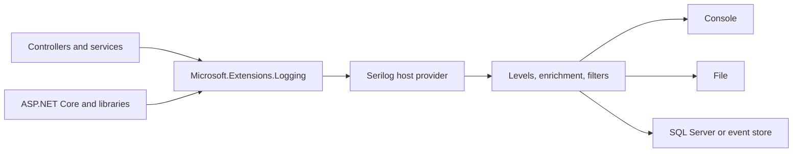

# What is Serilog?

Serilog is a .NET logging library that represents each occurrence as a structured event. An event carries severity, timestamp, a message template, typed properties, and optionally an exception. Sinks send the event to destinations; enrichers add useful context; filters and minimum levels control volume.

## How Serilog fits a .NET application

The application can depend on `Microsoft.Extensions.Logging.ILogger<T>`. `Serilog.AspNetCore` plugs the Serilog pipeline into the ASP.NET Core host, so application and framework log calls can use the same configured destinations. Serilog’s own API is available where needed, while the common .NET abstraction avoids binding application services to a specific logging implementation.

## Why teams use it

- **Structured events:** query event fields instead of scraping prose.
- **Configurable routing:** direct different severities to multiple destinations.
- **Context:** attach application, request, and trace metadata consistently.
- **Extensible destinations:** choose independent sink packages for specific stores.
- **Integration:** preserve the `ILogger<T>` pattern used by ASP.NET Core and libraries.

Serilog does not provide a central dashboard or every sink in its core package. Select and operate those packages separately.

## When to use `Log` and `ILogger<T>`

Use injected `ILogger<T>` in services and controllers. It scopes events with a category and fits dependency injection. The static `Log` API is useful for bootstrap logging before the host exists and for small standalone examples. Avoid global static calls throughout business code because they hide dependencies and make tests harder.

## References

- [Serilog repository](https://github.com/serilog/serilog)
- [Serilog configuration basics](https://github.com/serilog/serilog/wiki/Configuration-Basics)

